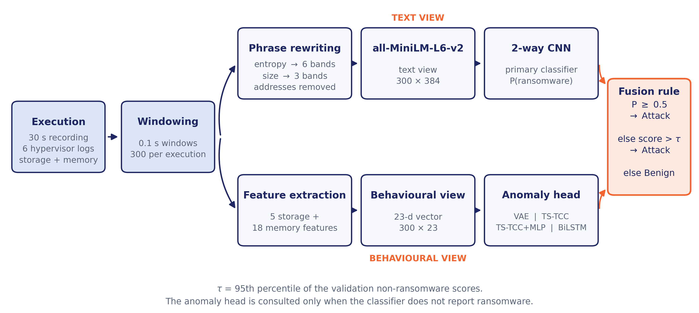

# Detecting Ransomware Attacks from Hypervisor-Level Storage and Memory Traces

**A comparison of anomaly detection methods across supervision levels**

M.Sc. Directed Study — Department of Computer Science, Western University
Arshad Ahmed · Supervisor: Marwa Elsayed

---

## What this is

A ransomware detector built on hypervisor-level storage and memory access traces, used to answer one question:

> To what extent do anomaly-detection methods with different levels of supervision improve the detection of unseen ransomware variants and families when added to a hypervisor-level classifier?

Four detection heads — spanning unsupervised generative, unsupervised contrastive, semi-supervised and supervised learning — are placed in an identical pipeline slot at a matched 5% false-positive rate, then evaluated along three axes: held-out variants of a known family, families withheld from training entirely, and a second dataset.

## The finding

Label information buys you the family you already know. It buys you nothing against the family you do not.

| Head | Supervision | Variant recall | Conti_06 | Cross-family |
|---|---|---|---|---|
| VAE | Unsupervised, generative | 89% | 30% | 70% |
| TS-TCC | Unsupervised, contrastive | 93% | 50% | **85%** |
| TS-TCC + head | Semi-supervised | 98% | 87% | 82% |
| BiLSTM | Supervised | **99%** | **90%** | 80% |

Within family, supervision is decisive — Conti_06 recall climbs 30 → 50 → 87 → 90. Cross-family the ordering collapses and inverts: no method exceeds ~86%, and the best result belongs to the method given no labels at all.

The mechanism is a decision boundary. A supervised head learns to separate ransomware from non-ransomware using the families it was shown; a family withheld entirely can fall on the wrong side of a line drawn without it. WannaCry is the clearest case — it writes high-entropy data in 15% of its windows against 0.1–0.3% for the other five families, a profile closest to AESCrypt (8.3%) and Zip (7.3%). A label-trained head has been taught to reject exactly that profile, and rejects WannaCry with it (19–24%). The unsupervised head, which never learned that boundary, reaches 76%.

## Pipeline



Each 30-second execution is cut into 300 windows of 0.1 s and encoded into two parallel views — a 23-dimensional behavioural vector and a 384-dimensional text embedding produced by rewriting log lines as categorical phrases and encoding them with `all-MiniLM-L6-v2`. A two-way CNN over the text view makes the primary decision; an anomaly head over the behavioural view is consulted only for executions the classifier does not flag.

## Dataset

This repository does **not** redistribute the data. RanSMAP is published by its authors:

- Paper — Hirano, M., Kobayashi, R., 2025. *RanSMAP: open dataset of ransomware storage and memory access patterns for creating deep learning based ransomware detectors.* Computers & Security 150, 104202.
- Data — https://github.com/manabu-hirano/RanSMAP

Place it at `dataset/` and run `feature_extraction.py` to regenerate the feature arrays.

## Reproducing

```bash
pip install -r requirements.txt

python feature_extraction.py          # dataset/ -> features/ (23-d behavioural view)
jupyter nbconvert --execute 03_text_embedding_generation.ipynb   # -> text_sequences.npy
python binary_fusion.py               # 2-way CNN + BiLSTM head + fusion
python d3_fixed.py                    # VAE head
python ts_tcc_fusion.py               # TS-TCC head
python bilstm_lofo_retrained.py       # cross-family, per-fold retraining
python component_ablation_final.py    # component attribution
python heldout_fpr_split.py           # non-circular FPR
python latency_benchmark.py           # latency profile
```

Scripts carry hardcoded cluster paths (`/scratch/.../RanSMAP/features`) from the environment they were run in; adjust `FEATURES_DIR` at the top of each before running locally.

## Repository layout

| Path | Contents |
|---|---|
| `RanSMAP_Complete_Project_Record.md` | **Start here** — full technical record, start to finish |
| `feature_extraction.py` | 23-d behavioural features (paper Figs D.1, D.2) |
| `03_text_embedding_generation.ipynb` | Text serialisation + MiniLM encoding |
| `06_embedding_comparison.ipynb` | fastText / MiniLM / mpnet comparison |
| `binary_fusion.py` | 2-way CNN, BiLSTM head, binary fusion rule |
| `d3_fixed.py`, `vae_nonran_only.py`, `vae_ranonly.py` | VAE head and training-pool variants |
| `ts_tcc_fusion.py`, `ts_tcc_semisup.py` | TS-TCC unsupervised and semi-supervised heads |
| `bilstm_lofo_retrained.py` | Leave-one-family-out with per-fold retraining |
| `component_ablation_final.py`, `channel_ablation_table.py` | Ablations |
| `heldout_fpr_split.py` | Non-circular false-positive measurement |
| `session_leakage_diagnostic.py` | Collection-session reconstruction and exposure |
| `ransap_eval.py`, `ransap_feature_sanity.py` | Cross-dataset evaluation and scale diagnosis |
| `latency_benchmark.py`, `latency_full_profile.py` | Latency measurement |
| `Results.md` | Every experimental result, most recent first |
| `HANDOFF.md` | Dated decision and status log |

## Known limitations

Stated here because they qualify every number above.

**Session exposure.** The training/validation split is stratified by class label, not grouped by collection session. Reconstructing sessions from collection timestamps gives 227 sessions across 1,970 executions, and all 180 validation non-ransomware executions have a same-session sibling in the training pool. The 5% false-positive rate may therefore be optimistic. Variant and cross-family recall are unaffected, since those classes and families are withheld wholesale.

**Not a real-time detector.** Inference costs 0.82 ms per execution, but mean time to detection is 24.3 s — evidence accumulates across most of the 30-second window. This is an execution-level detector with computationally feasible inference, not a demonstrated real-time one.

**Cross-dataset transfer is invalid as executed.** Read and write throughput are recorded ~900× apart between RanSMAP and RanSAP, so the scaler does not transfer. Reported as exploratory only.

**Small samples.** Conti_06 is ten executions — one execution moves recall by ten points, and the head comparisons at that scale are not statistically separable. Cross-family runs use a single seed per fold.

## Citation

```bibtex
@mastersthesis{ahmed2026ransmap,
  author = {Ahmed, Arshad},
  title  = {Detecting Ransomware Attacks from Hypervisor-Level Storage and
            Memory Traces: A Comparison of Anomaly Detection Methods
            Across Supervision Levels},
  school = {Western University},
  type   = {M.Sc. Directed Study},
  year   = {2026}
}
```
